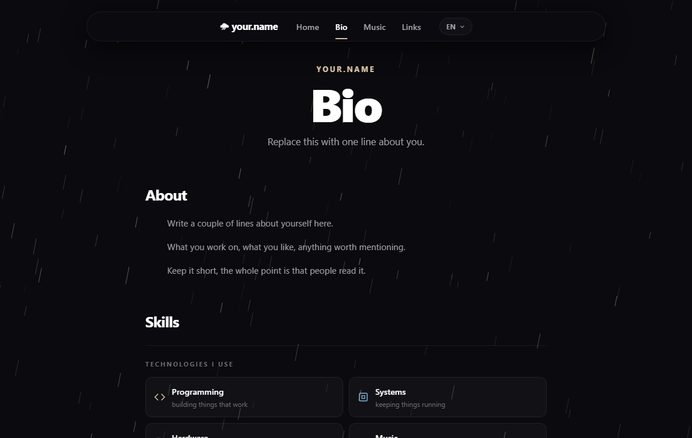
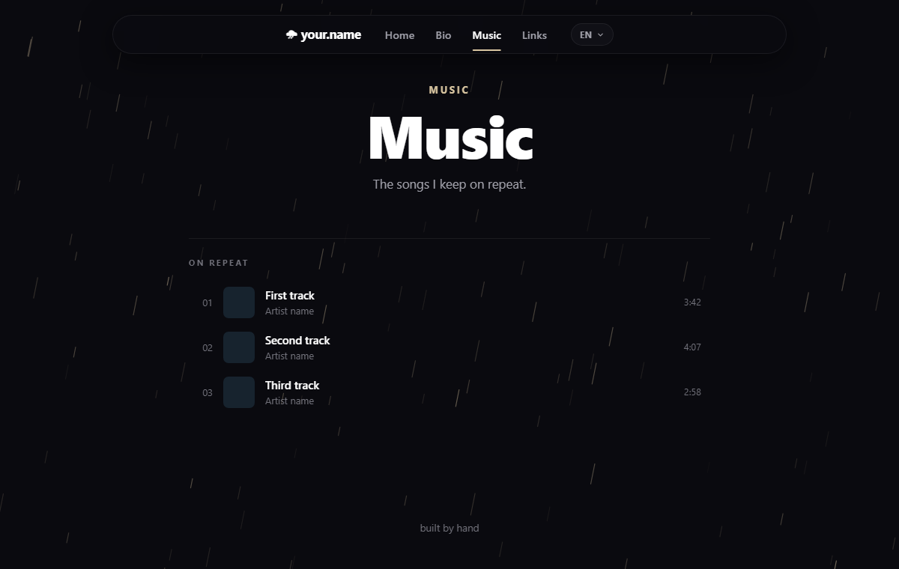
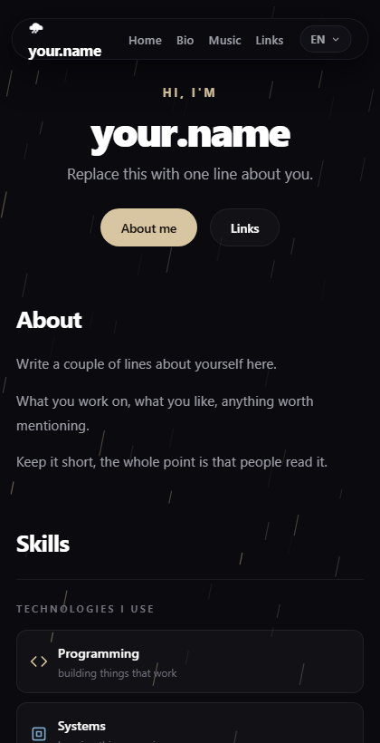
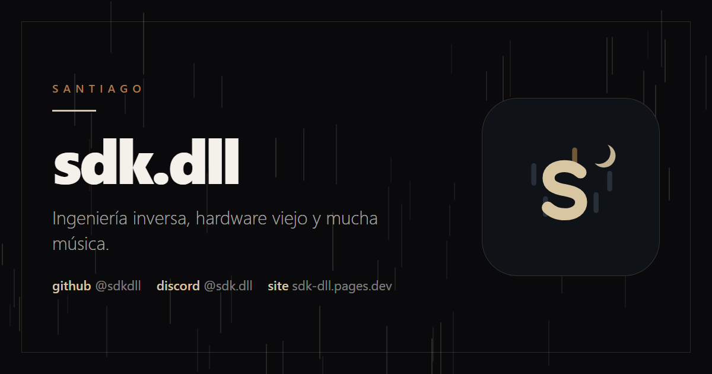

# personal-site

Personal site with a live Discord presence card, a music page and a small
translation setup. Static front end, one Express endpoint, deploys to Vercel
or Cloudflare Pages.

Plain HTML, CSS and JavaScript. No framework, no bundler, no build step, no
tracking, no cookie banner.


<table>
  <tr>
    <td width="33%"></td>
    <td width="33%"></td>
    <td width="33%"></td>
  </tr>
  <tr>
    <td align="center"><sub>Bio</sub></td>
    <td align="center"><sub>Music</sub></td>
    <td align="center"><sub>Mobile</sub></td>
  </tr>
</table>

## Running it

```bash
npm install
cp .env.example .env
npm run dev
```

Open http://localhost:3001

## What you get

- **Live Discord presence** — avatar, status and whatever you are playing or
  listening to, refreshed every few seconds.
- **Client-side navigation** — moving between pages swaps the content without
  reloading the document. Nothing flickers, the scroll position is not lost
  and the player keeps running.
- **A real favicon set** — SVG source plus the PNGs browsers and phones ask
  for, an `apple-touch-icon` and a web manifest.
- **Skeleton loaders** — the presence card and the cover art show a soft
  pulsing block until the real data arrives, so nothing jumps or flashes.
- **SEO ready** — canonical URLs, Open Graph and Twitter cards, JSON-LD
  structured data, `robots.txt`, `sitemap.xml` and `llms.txt`.
- **Two languages** — English and Spanish out of the box. Add more by
  copying a block in `js/i18n.js`.
- **A self-check** — `node scripts/audit.cjs` verifies all of the above.

## The presence card

The card on the home page shows your Discord avatar, status and whatever
you are listening to or playing.

It reads from [Lanyard](https://github.com/Phineas/lanyard), which mirrors
your Discord client. Two things are needed:

1. Join the [Lanyard Discord server](https://discord.gg/lanyard) so your
   status is reported.
2. Put your Discord user id in `.env`:

```
LANYARD_USER_ID=123456789012345678
```

To get your id: Discord → Settings → Advanced → Developer Mode → right click
your name → Copy User ID.

In Discord, connect Spotify under Settings → Connections if you want the
current song to show up.

## Adding tracks

Edit `js/tracks-data.js`. Each entry looks like this:

```js
{
  title: 'Song name',
  artist: 'Artist name',
  album: 'Album name',
  length: '3:42',
  cover: 'https://.../cover.jpg',
  url: 'https://...'
}
```

Cover images are optional.

The track list is written into `music.html` as real HTML when you build, so
the view source is never empty and crawlers and AI assistants can read it.
`js/tracks.js` only makes those rows interactive.

## Translations

Strings live in `js/i18n.js`. Every entry needs a key in each language
object. Add a language by copying a block and adding it to `LANGUAGES`.

The choice is stored in `localStorage`, and the `lang` attribute of
`<html>` follows along with it.

## Adding a page

Create the file, add it to the nav in the three existing pages, and add the
route to `vercel.json` if you want a clean URL for it.

`js/router.js` intercepts internal links, fetches the page and swaps the
`<main>` element. It only handles same-origin `.html` links, falls back to a
normal navigation if anything fails, and prefetches on hover.

## The icon

`assets/favicon.svg` is the source. It is plain SVG, so edit it and
regenerate the PNGs when you change it:

```bash
npm i -D playwright-core
node scripts/iconos.cjs
```

That writes `favicon-32x32.png`, `apple-touch-icon.png` and `icon-512.png`.
The three HTML files already link them, plus `assets/manifest.json` for
installable-to-homescreen.

| Icon | Social preview |
| --- | --- |
|  |  |

The social preview image lives next to them:

```bash
node scripts/og.cjs
```

That writes `assets/og-image.png` (1200×630), which the Open Graph and
Twitter tags point at.

## Colours

Everything is driven by four variables at the top of `css/style.css`:

```css
--accent: #d8c5a1;        /* beige */
--accent-dark: #a8794a;    /* marron */
--accent-soft: rgba(216, 197, 161, 0.12);
--bg: #0a0a0f;
```

Swap them for your own palette. There are no gradients anywhere on purpose.

## Loading

The presence card and the track covers show a placeholder (a soft pulsing
block) until the real data arrives. It uses the `.sk` class:

```html
<span class="sk sk-line">text goes here</span>
```

`js/profile.js` and `js/tracks.js` remove the class when the data lands.
If the API never answers, the placeholders are dropped after 8 seconds so
the page never stays stuck.

## SEO

Every page has its own title, meta description and canonical URL, plus
Open Graph and Twitter card tags. The structured data is JSON-LD:

| Page | Type |
| --- | --- |
| `index.html` | `Person` + `WebSite` |
| `bio.html` | `ProfilePage` |
| `music.html` | `MusicPlaylist` |

`robots.txt` allows search engines and explicitly allows AI crawlers
(GPTBot, ClaudeBot, PerplexityBot, Google-Extended and others).
`sitemap.xml` lists the three pages and `llms.txt` describes the site for
assistants.

The domain lives in one place, `scripts/build.js`:

```js
const SITE_URL = process.env.SITE_URL || 'https://personal-site-sdkdll.vercel.app';
```

Change it (or export `SITE_URL`) and the canonical URLs, the Open Graph
tags, `robots.txt`, `sitemap.xml` and `llms.txt` all update at once.

## Checking your work

```bash
npm run audit
```

It checks the things that make a site look generated instead of made:
unique titles and descriptions, canonical and Open Graph tags, valid JSON-LD,
one `<h1>` per page, `alt` text on every image, the favicon and manifest,
`robots.txt` and `sitemap.xml`, secrets in the client code, source maps,
gradients, bundle size and the security headers. It prints a pass/fail line
per check.

```
  AUDITORÍA DEL SITIO

  OK    View source con contenido real (index.html)  — 423 caracteres de texto
  OK    Títulos únicos por página  — your.name — Personal site | Bio | Music
  OK    Meta description única y con largo útil  — 131 / 130 / 121 / 112
  OK    Datos estructurados en index.html  — Person + WebSite
  OK    Canonical en bio.html
  OK    Open Graph completo en music.html
  OK    Un solo <h1> en index.html  — 1
  OK    Landmark <main> en index.html
  OK    robots.txt permite explícitamente a los asistentes de IA
  OK    Sin claves ni tokens en el código que llega al navegador
  OK    Sin bundle gigante  — 210 KB totales
  ...
  63/63 comprobaciones correctas
```

## Deploying

Push to `main` and the workflow in `.github/workflows/deploy.yml` handles it.
Add these secrets in the repo settings first:

| Secret | Where it comes from |
| --- | --- |
| `CLOUDFLARE_API_TOKEN` | Cloudflare → My Profile → API Tokens → Edit |
| `CLOUDFLARE_ACCOUNT_ID` | Cloudflare dashboard, right sidebar |
| `VERCEL_TOKEN` | Vercel → Settings → Account → Tokens |

Create the Vercel token in the dashboard. The tokens the CLI writes to disk
expire on their own and break the workflow a few days later.

To deploy by hand instead:

```bash
npx vercel --prod
```

Environment variables for the dashboard:

| Variable | Value |
| --- | --- |
| `LANYARD_USER_ID` | your Discord user id |
| `NODE_ENV` | `production` |

Cloudflare Pages works too. Put the build output in `public/` and the API
function in `api/index.js`.

## Before you publish

- Replace `your.name` and `your-username` in the three HTML files
- Fill in `js/tracks-data.js`
- Write the About section in `js/i18n.js`
- Replace the favicon and the social preview image with your own
- Set `SITE_URL` in `scripts/build.js` (or as an environment variable)
- Update the copyright line in `LICENSE`
- Run `node scripts/audit.cjs` and fix whatever it reports

## Note on 404 pages

`404.html` is used as-is by Cloudflare Pages and by most static servers.

Vercel serves `index.html` for unknown paths instead, since it treats the
project as a single page app. If you want a real 404 on Vercel, add a
redirect with `status: 404` to `vercel.json` before the catch-all.

## Layout

```
index.html          home
bio.html            about
music.html          tracks
404.html            not found
css/style.css       styles
js/
  i18n.js           translations
  lang.js           language switcher
  main.js           rain background, reveal, skeletons
  profile.js        presence card
  router.js         navigation without reloading
  tracks-data.js    your tracks
  tracks.js         track list
server/app.js       Express app
api/index.js        serverless entry for Cloudflare Pages
scripts/
  build.js          copies files into public/ with a version hash
  iconos.cjs        regenerates the favicon PNGs from the SVG
  og.cjs            regenerates the social preview image
  capturas.cjs      takes the screenshots used in this README
  audit.cjs         checks the site and prints a report
assets/
  favicon.svg       source of the icon
  manifest.json     web manifest
  og-image.png      social preview
  preview-home.png  screenshot of the home page
  preview-bio.png   screenshot of the bio page
  preview-music.png screenshot of the music page
  preview-mobile.png screenshot on a phone
robots.txt          crawler rules
sitemap.xml         page list
llms.txt            summary for AI assistants
```

## License

MIT
