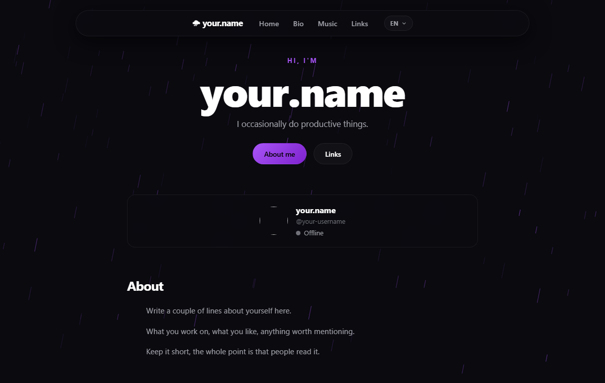

# personal-site

Personal site with a live Discord presence card, a music page and a small
translation setup. Static front end, one Express endpoint, deploys to Vercel
or Cloudflare Pages.



## Running it

```bash
npm install
cp .env.example .env
npm run dev
```

Open http://localhost:3001

## The presence card

The card on the home page shows your Discord avatar, status and whatever
you are listening to or playing.

It reads from [Lanyard](https://github.com/Phineas/lanyard), which mirrors
your Discord client. Two things are needed:

1. Join the [Lanyard Discord server](https://discord.gg/lanyard) so your
   status is reported.
2. Put your Discord user id in `.env`:

```
LANYARD_USER_ID=123456789012345678
```

To get your id: Discord → Settings → Advanced → Developer Mode → right click
your name → Copy User ID.

In Discord, connect Spotify under Settings → Connections if you want the
current song to show up.

## Adding tracks

Edit `js/tracks-data.js`. Each entry looks like this:

```js
{
  title: 'Song name',
  artist: 'Artist name',
  album: 'Album name',
  length: '3:42',
  cover: 'https://.../cover.jpg',
  url: 'https://...'
}
```

Cover images are optional.

## Translations

Strings live in `js/i18n.js`. Every entry needs a key in each language
object. Add a language by copying a block and adding it to `LANGUAGES`.

The choice is stored in `localStorage`.

## Adding a page

Create the file, add it to the nav in the three existing pages, and add the
route to `vercel.json` if you want a clean URL for it.

## Deploying

Push to `main` and the workflow in `.github/workflows/deploy.yml` handles it.
Add these secrets in the repo settings first:

| Secret | Where it comes from |
| --- | --- |
| `CLOUDFLARE_API_TOKEN` | Cloudflare → My Profile → API Tokens → Edit |
| `CLOUDFLARE_ACCOUNT_ID` | Cloudflare dashboard, right sidebar |
| `VERCEL_TOKEN` | Vercel → Settings → Account → Tokens |

To deploy by hand instead:

```bash
npx vercel --prod
```

Environment variables for the dashboard:

| Variable | Value |
| --- | --- |
| `LANYARD_USER_ID` | your Discord user id |
| `NODE_ENV` | `production` |

Cloudflare Pages works too. Put the build output in `public/` and the API
function in `api/index.js`.

## Before you publish

- Replace `your.name` and `your-username` in the three HTML files
- Fill in `js/tracks-data.js`
- Write the About section in `js/i18n.js`
- Update the copyright line in `LICENSE`

## Layout

```
index.html          home
bio.html            about
music.html          tracks
css/style.css       styles
js/
  i18n.js           translations
  lang.js           language switcher
  main.js           rain background
  profile.js        presence card
  tracks-data.js    your tracks
  tracks.js         track list
server/app.js       Express app
api/index.js        serverless entry for Cloudflare Pages
scripts/build.js    copies files into public/ with a version hash
```

## License

MIT
